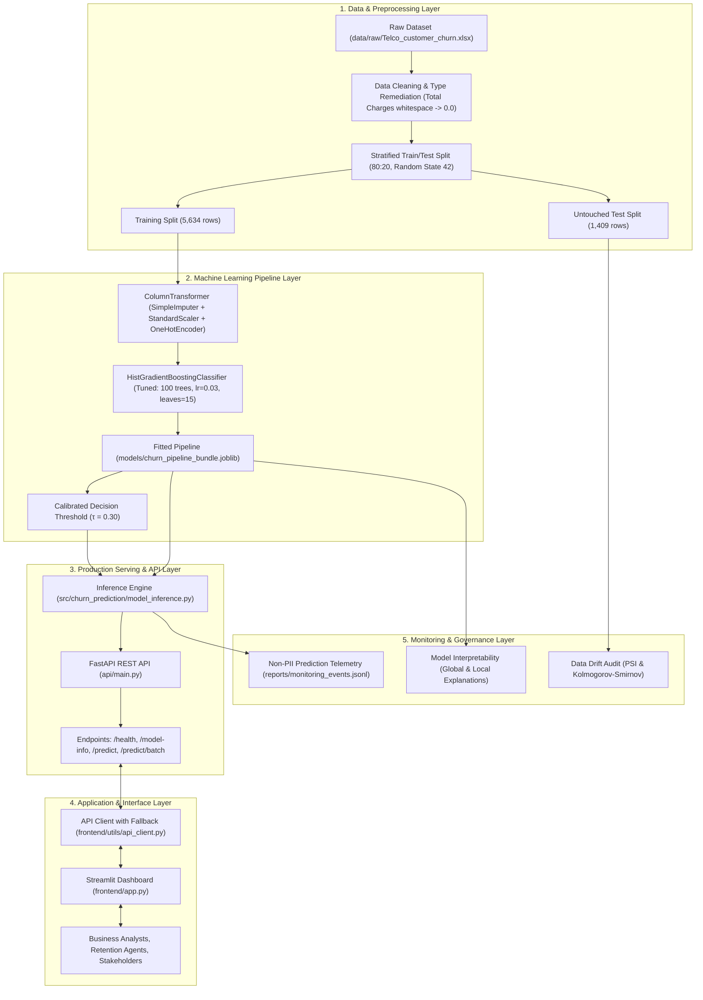

# End-to-End System Architecture

---

## Architecture Flow Breakdown

1. **Data Ingestion & Integrity:**
   - Raw data is loaded and validated for primary keys and target distributions.
   - Whitespace anomalies in `Total Charges` are resolved without record deletion.
   - Stratified train/test split isolates 20% of data for final evaluation.
2. **Leakage-Free Transformation Pipeline:**
   - Preprocessing steps (`StandardScaler`, `OneHotEncoder`) are encapsulated inside a Scikit-Learn `ColumnTransformer`.
   - Transformations are fitted exclusively on training folds during 5-fold cross-validation.
3. **Optimized Inference Engine:**
   - Persisted as a self-contained Joblib bundle combining pipeline weights, threshold (`0.30`), and metadata.
   - Fast sub-15ms CPU inference.
4. **Decoupled REST API & Frontend:**
   - FastAPI handles Pydantic schema validation, batching, and health probes.
   - Streamlit provides an intuitive interface for frontline retention agents.
5. **Observability & Drift Monitoring:**
   - Telemetry tracks serving latency, risk category distributions, and population stability indices.
