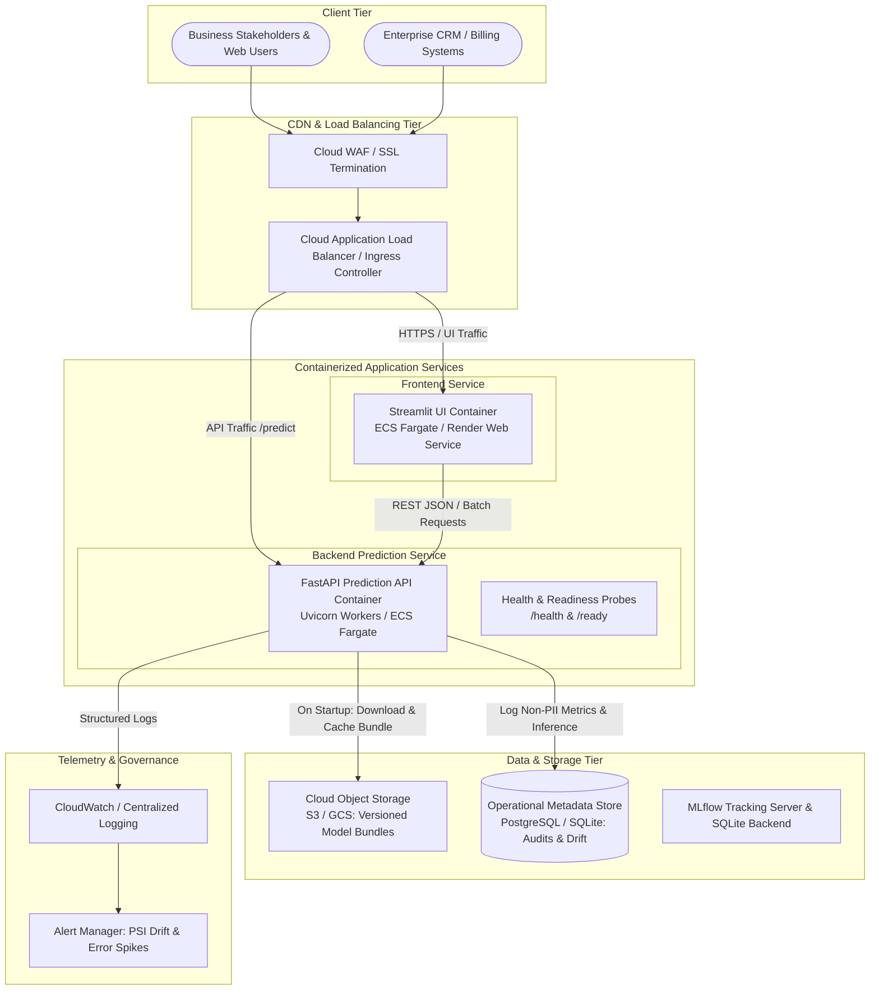

# Cloud Architecture & Scalability Specification

## 1. System Overview & Architecture Diagram

The Customer Churn Prediction system is designed as a **decoupled, stateless microservices architecture** optimized for low-latency batch and real-time inferencing.

---

## 2. Component Communications & Data Flow

1. **Client Ingestion:**
   - HTTPS traffic arrives through the Load Balancer/Reverse Proxy.
   - SSL certificates are terminated at the ingress boundary.
2. **Stateless API Serving:**
   - FastAPI endpoints (`/predict`, `/predict/batch`, `/health`, `/ready`) are completely stateless.
   - The Scikit-learn Pipeline bundle (`models/churn_pipeline_bundle.joblib` or `s3://...`) is loaded once into worker memory at process startup via the lifespan handler.
   - Zero state is retained in container local memory across requests, enabling horizontal autoscaling (HPA) from 1 to 20 replicas based on CPU or request queue depth.
3. **Artifact Decoupling:**
   - Model bundles are decoupled from application container images using `src/churn_prediction/artifact_storage.py`.
   - In production, models can be loaded dynamically from immutable S3/GCS buckets using environment variable `MODEL_ARTIFACT_URI=s3://telco-churn-models-prod/v1/churn_pipeline_bundle.joblib`.
4. **Data Privacy & Telemetry:**
   - Prediction requests do not log PII (Personal Identifiable Information such as customer names or exact address coordinates).
   - Only non-PII operational metadata (latency, prediction probability, churn flag, input feature distributions for PSI/drift calculations) is logged to `MetadataDB`.

---

## 3. Platform Comparison & Deployment Options

| Dimension | Tier 1: Free / Hobby (Render + HF Spaces) | Tier 2: Managed Cloud (AWS ECS Fargate) | Tier 3: Hyperscaler ML Platform (AWS SageMaker / Vertex AI) |
| :--- | :--- | :--- | :--- |
| **Backend Compute** | Render Free Web Service (512MB RAM, shared CPU) | ECS Fargate (0.5 vCPU, 1GB RAM task) | SageMaker Real-time Endpoint (`ml.t3.medium`) |
| **Frontend Compute** | Hugging Face Spaces / Streamlit Cloud (Free) | ECS Fargate container behind ALB | Separate ECS / App Runner |
| **Model Storage** | Git LFS / Embedded in Docker image | Amazon S3 Standard + Versioning | S3 / SageMaker Model Registry |
| **Autoscaling** | No (manual upgrade required) | Yes (Target Tracking CPU / Concurrency) | Yes (Native SageMaker Auto Scaling) |
| **Est. Monthly Cost**| **\$0.00 / month** | **\$22.00 – \$45.00 / month** | **\$75.00 – \$150.00 / month** |
| **Portfolio Value** | High (accessible live demo URL for recruiters) | Very High (demonstrates enterprise cloud IaC) | High (enterprise ML specialization) |

**Recommendation:** For data science portfolio presentation, use **Tier 1 (Render API + HF Spaces Frontend)** for zero-cost live public demonstration, accompanied by the **Tier 2 Terraform specification (`infrastructure/main.tf`)** demonstrating enterprise AWS production architecture to technical interviewers.
