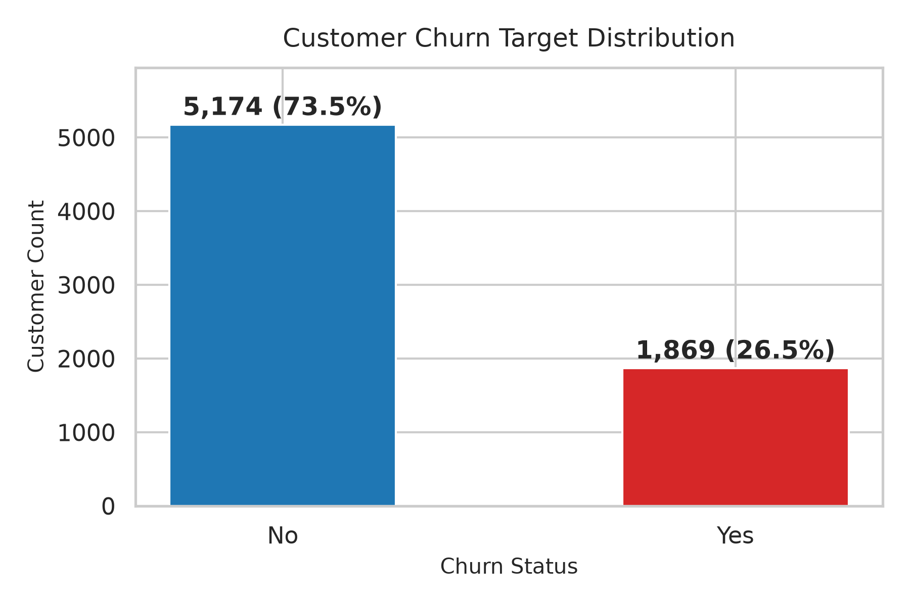
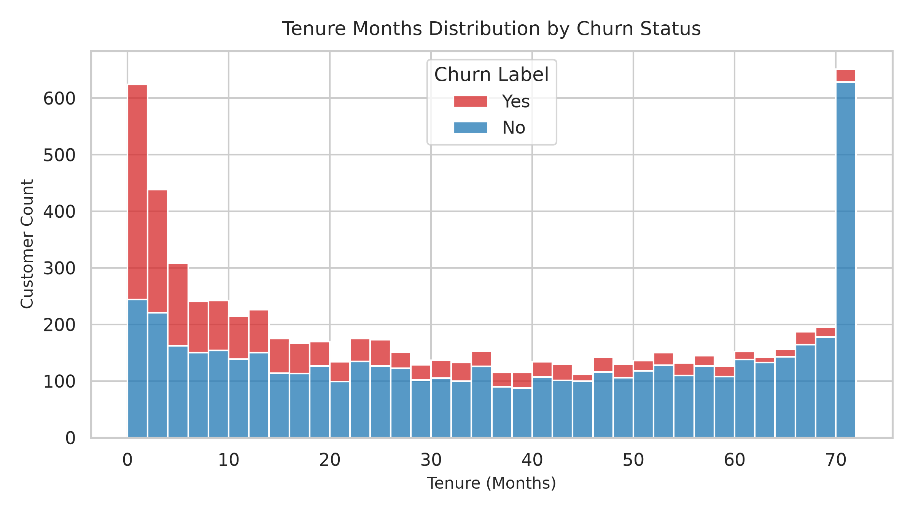
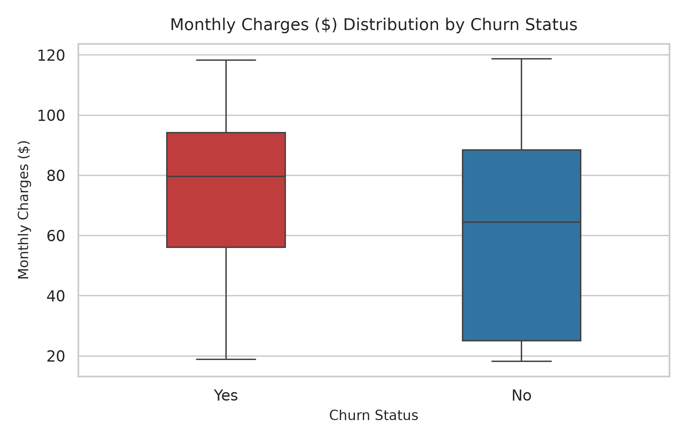
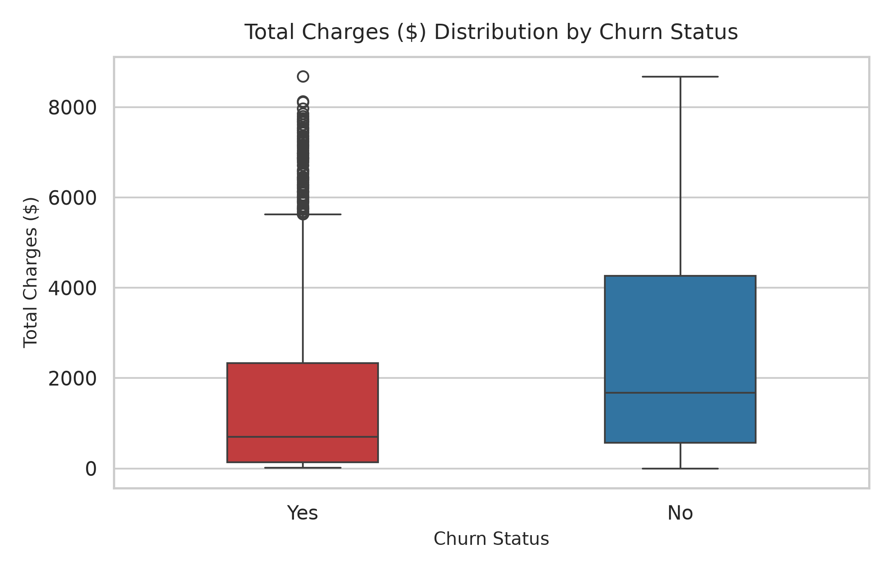
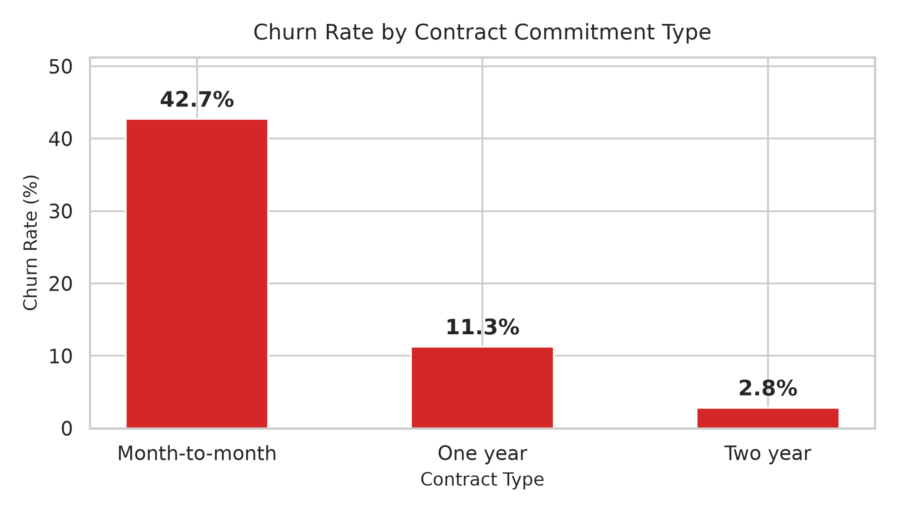
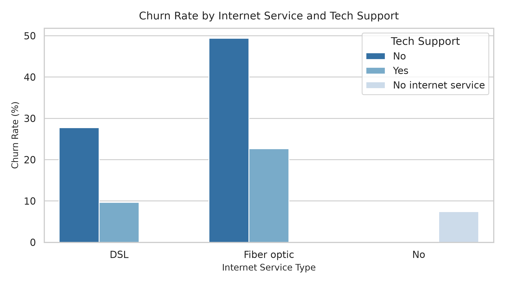
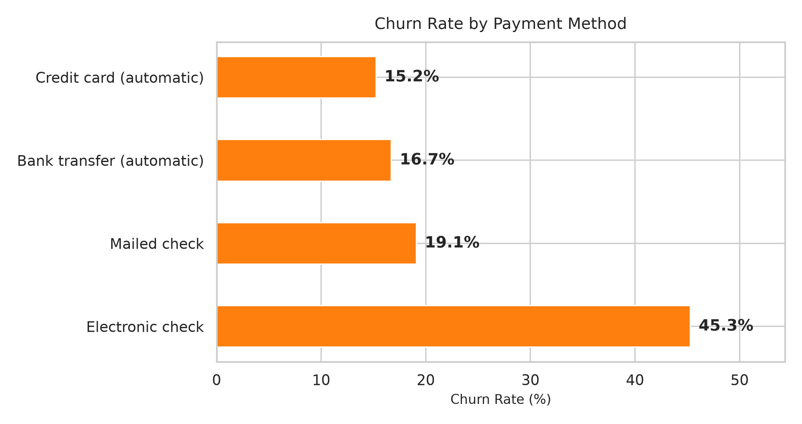
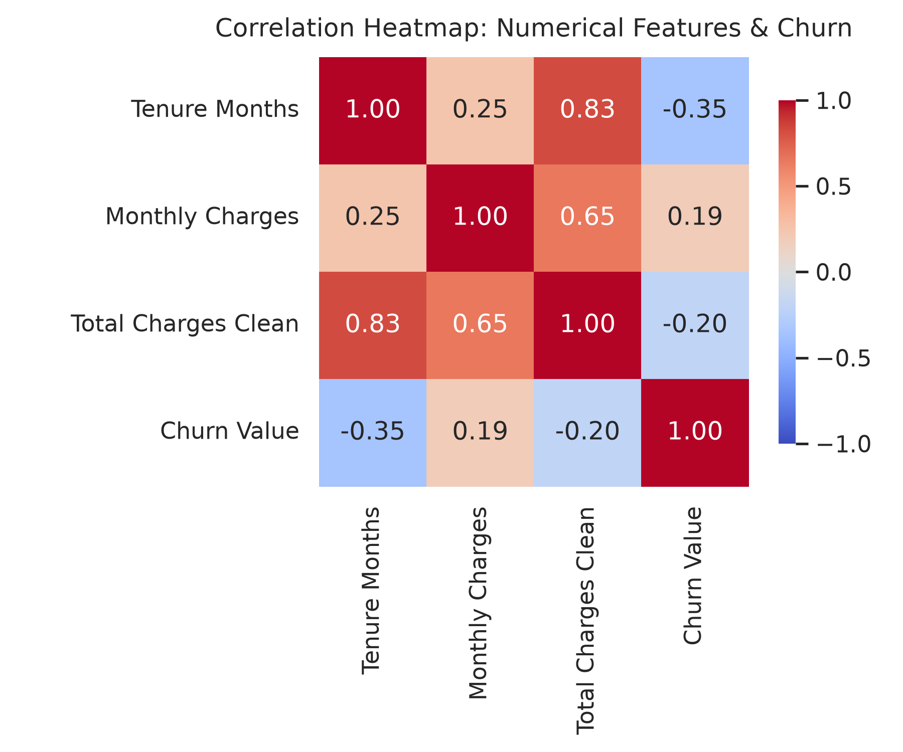

# Phase 3: Exploratory Data Analysis (EDA) Report

## 1. Executive Summary & Objective

This report documents exploratory data analysis on the IBM Telco Customer Churn dataset (7,043 customer accounts). The objective is to identify behavioral, contract, and demographic drivers of customer churn, quantify feature distributions, and uncover risk patterns to inform feature engineering and modeling.

---

## 2. Target Variable & Class Distribution

The target variable is `Churn Value` (with string equivalent `Churn Label`):
- **Retained Customers (`No` / `0`):** 5,174 accounts (73.46%)
- **Churned Customers (`Yes` / `1`):** 1,869 accounts (26.54%)
- **Imbalance Ratio:** ~2.77 : 1 (Non-churn to Churn)

### Analytical Implication
Because 73.46% of customers do not churn, a naive majority-class classifier predicting "No Churn" for every customer would achieve an apparent accuracy of 73.46% while failing to detect a single churner (0% recall). Consequently, model evaluation must emphasize **ROC-AUC**, **PR-AUC**, **Recall**, and **F1-Score**.

---

## 3. Univariate & Bivariate Feature Analysis

### A. Customer Tenure Dynamics
- **Median Tenure for Churned Customers:** 10.0 months
- **Median Tenure for Retained Customers:** 38.0 months
- **Distribution Pattern:** Churn exhibits a steep decay curve. Defections are heavily concentrated during the first 12 months (peaking in months 1–4). After 24 months, customer retention stabilizes significantly.

### B. Billing & Financial Dynamics
- **Monthly Charges:**
  - Churned customer median: **$79.65 / month** (IQR: $56.15 – $89.85)
  - Retained customer median: **$64.43 / month** (IQR: $25.10 – $88.40)
  - *Finding:* Churn is substantially higher among customers paying premium monthly rates ($70–$100). Bimodal distribution in monthly charges is driven by customers on basic phone-only plans (~$20) vs broadband bundles ($70+).

- **Total Charges:**
  - Churned customer median is lower ($701.55) compared to retained customers ($1,683.60).
  - This is not a paradox: churners leave early in their lifecycle, accumulating far lower cumulative spend despite higher monthly rates.

### C. Contract Commitment Structures
Contract length is the single strongest univariate predictor of customer retention:
- **Month-to-month contracts:** **42.71% churn rate** (1,655 churners out of 3,875 accounts)
- **One-year contracts:** **11.27% churn rate** (166 churners out of 1,473 accounts)
- **Two-year contracts:** **2.83% churn rate** (48 churners out of 1,695 accounts)

*Insight:* Over 88.5% of all churners were on month-to-month agreements. Customers willing to commit to annual agreements have switching barriers and higher satisfaction.

### D. Internet Service & Value-Added Support Services
- **Fiber Optic:** High churn rate of **41.89%** (1,297 churners out of 3,096 subscribers).
- **DSL:** Moderate churn rate of **18.96%** (459 churners out of 2,421 subscribers).
- **No Internet Service (Phone Only):** Low churn rate of **7.40%** (113 churners out of 1,526 subscribers).

*The Technical Support Buffer:*
When Fiber Optic subscribers have **Tech Support**, churn drops dramatically from ~49% to ~22%. Subscribers with unassisted fiber connections face high service complexity, billing shocks, or reliability friction that drive defections.

### E. Payment Method Vulnerabilities
- **Electronic Check:** Churn rate is **45.29%** (1,071 churners out of 2,365 subscribers).
- **Mailed Check:** 19.11% churn rate.
- **Bank Transfer (Automatic):** 16.71% churn rate.
- **Credit Card (Automatic):** 15.24% churn rate.

*Insight:* Automatic payment methods (credit card and bank draft) reduce payment friction and active monthly evaluation, cutting churn rates by two-thirds compared to manual electronic check payments.

---

## 4. Multivariate & Correlation Analysis

### Key Numerical Relationships:
1. **Tenure vs Total Charges ($r = 0.83$):** Highly collinear. Total Charges is largely a deterministic function of $\text{Tenure} \times \text{MonthlyCharges}$. Tree ensembles handle this collinearity naturally, whereas regularized linear models benefit from scaling.
2. **Tenure vs Churn ($r = -0.35$):** Moderate negative linear association; customer survival probability increases monotonically with tenure.
3. **Monthly Charges vs Churn ($r = +0.19$):** Modest positive correlation reflecting higher defection propensity among premium price tiers.

---

## 5. Evidence-Based Business Insights

| Observation | Evidence / Statistics | Business Interpretation | Caveat / Alternative Explanation |
| :--- | :--- | :--- | :--- |
| **New Customer Vulnerability Window** | Median tenure of churners is 10 months; 50%+ churn occurs in year 1. | Onboarding and early customer success are failing to anchor customer value before the first annual threshold. | Early promotions (e.g. 3-month discount) may expire, triggering sudden churn. |
| **Contract Elasticity** | Month-to-month subscribers churn at 42.7% vs 2.8% for two-year contracts (15x difference). | Long-term contracts lock in customer retention. | Customers who already intend to churn naturally refuse to sign multi-year contracts (self-selection bias). |
| **Fiber Optic Service Dissatisfaction** | Fiber subscribers experience 41.9% churn despite paying premium fees ($80–$100). | Premium expectations are unmatched by service delivery, installation experience, or reliability. | Fiber optic competitors in California aggressively poach broadband customers with promotional switch-credits. |
| **Tech Support Retention Shield** | Adding Tech Support cuts Fiber Optic churn by over 50%. | Proactive issue resolution directly preserves customer lifetime value. | Customers requesting Tech Support may be more engaged users with higher switching barriers. |
| **Frictionless Payment Effect** | Automated payments cut churn from 45.3% (electronic check) to ~15.5%. | Passive billing minimizes monthly decision points and involuntary cancellations due to expired cards. | Electronic checks may be preferred by more budget-conscious, transient demographics. |

---

## 6. Analytical Limitations

1. **Cross-Sectional Snapshot:** The dataset captures a single static snapshot. Longitudinal usage trends (e.g., dropping data usage over 3 months prior to churn) are not available.
2. **Correlation vs. Causation:** Correlated features (e.g., electronic check payment or month-to-month contracts) are diagnostic risk markers, not necessarily root causes. Forcing a customer into an annual contract without addressing satisfaction will not prevent churn.
3. **California Geographic Homogeneity:** The dataset is drawn entirely from California subscribers; regional competitive dynamics may differ in other national markets.
