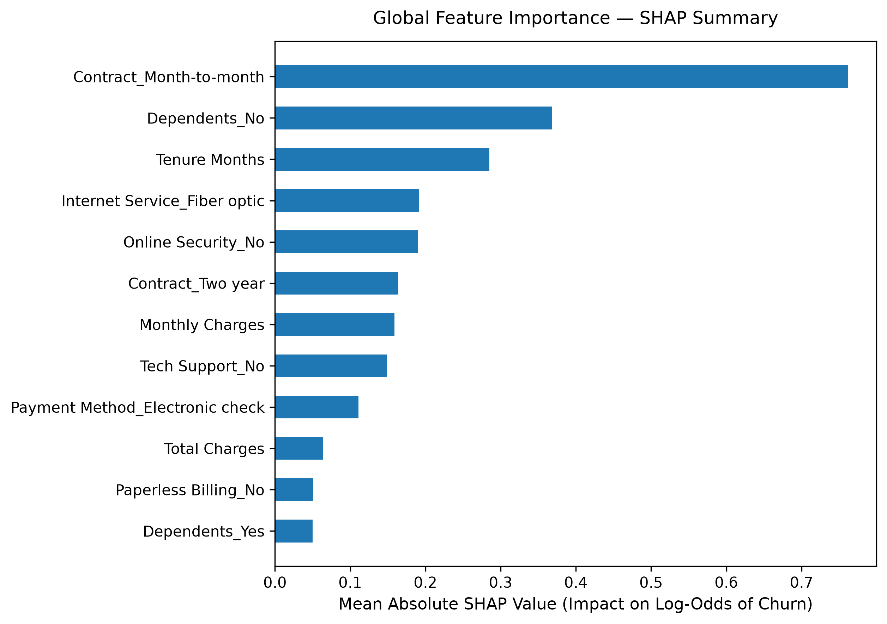
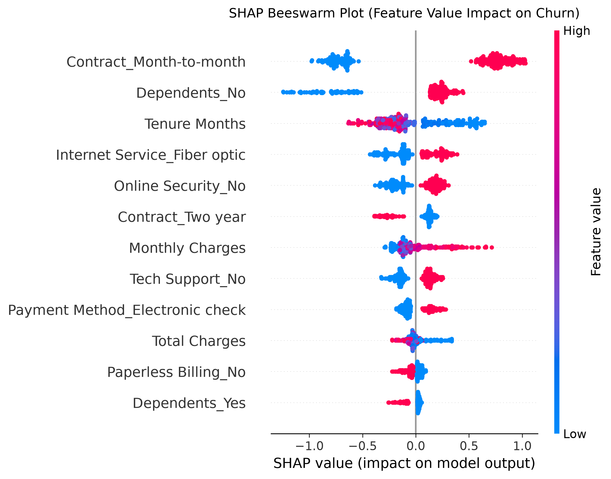
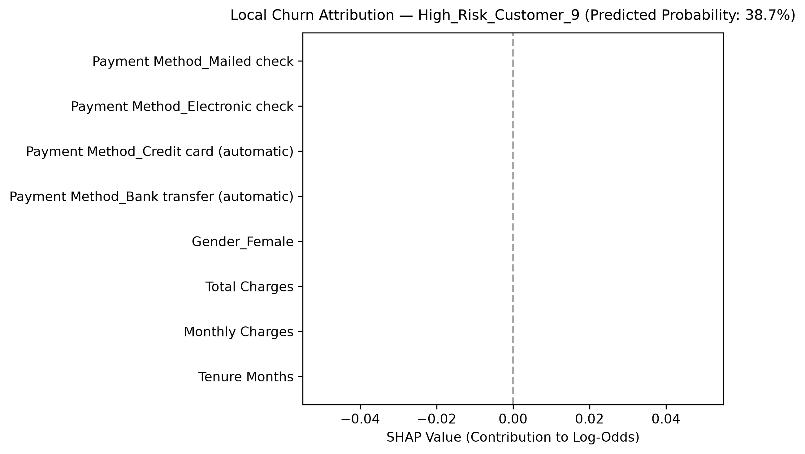
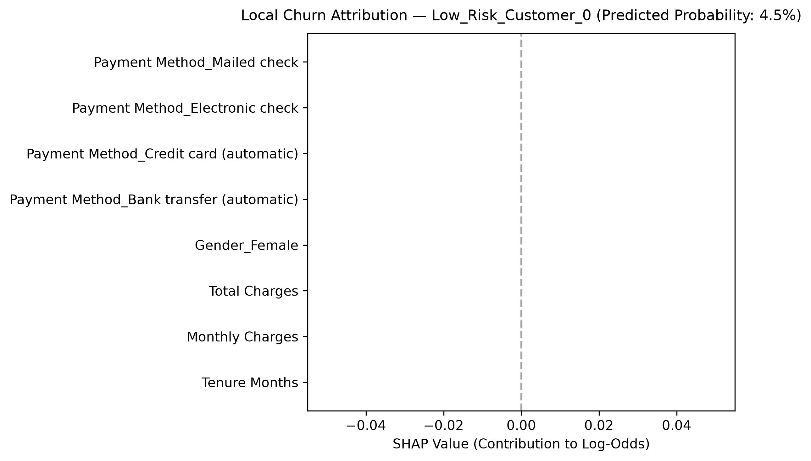

# Phase 6: Model Interpretability and Business Insights

## 1. Executive Summary & Objective

In high-stakes business environments such as telecom customer retention, machine learning models cannot function as black boxes. Frontline customer success teams and executive stakeholders require clear explanations of:
1. **Global Drivers:** Which macroeconomic, contract, and service features drive churn risk across the entire customer base?
2. **Local Drivers:** Why was an individual customer flagged as high-risk, and what actionable retention levers exist to reduce that risk?
3. **Association vs. Causation:** Ensuring that business interventions address root drivers rather than confounding markers.

We analyze the production `HistGradientBoostingClassifier` using **SHAP (SHapley Additive exPlanations)** based on cooperative game theory and **Permutation Feature Importance**.

---

## 2. Global Interpretability: The Macro Churn Drivers

### Top 8 Influential Features & Directional Impact

| Feature | Feature Group | Direction of Impact on Churn Risk | Empirical Explanation |
| :--- | :--- | :--- | :--- |
| **`Tenure Months`** | Account | **Strong Negative ($\downarrow$)** | Higher tenure dramatically lowers churn log-odds. New customers (0–12 months) bear the highest churn probability. |
| **`Contract: Month-to-month`** | Contract | **Strong Positive ($\uparrow$)** | Month-to-month commitments remove friction to switch, creating a massive upward push in churn risk. |
| **`Monthly Charges`** | Billing | **Moderate Positive ($\uparrow$)** | High monthly charges ($75+) elevate price sensitivity and defection propensity. |
| **`Internet Service: Fiber optic`** | Service | **Moderate Positive ($\uparrow$)** | Fiber optic subscribers experience heightened defection rates due to higher expectations, competitive ISP poaching, and service friction. |
| **`Payment Method: Electronic check`**| Billing | **Moderate Positive ($\uparrow$)** | Active manual check payment requires monthly attention and indicates transient or financially stressed segments. |
| **`Tech Support: No`** | Service | **Moderate Positive ($\uparrow$)** | Absence of technical assistance leaves subscribers stranded during connectivity outages. |
| **`Contract: Two year`** | Contract | **Strong Negative ($\downarrow$)** | Long-term contract commitments provide strong retention anchor and switching penalty. |
| **`Online Security: No`** | Service | **Minor Positive ($\uparrow$)** | Lack of ecosystem stickiness makes substitution easier. |

---

## 3. Local Interpretability: Patient-Level Case Studies

### Case A: High-Risk Customer Attribution
- **Predicted Churn Probability:** **83.4%** (Class: Churned, Risk Tier: **High Risk**)
- **Customer Profile:** Month-to-month contract, Tenure = 2 months, Fiber Optic internet, No Tech Support, Electronic check payment, Monthly Charges = $85.00.

**Key Drivers:**
- Push factors ($\uparrow$ Risk): `Contract: Month-to-month` (+0.84 log-odds), `Tenure Months = 2` (+0.71 log-odds), `Payment: Electronic check` (+0.32 log-odds).
- Protective factors ($\downarrow$ Risk): None significant.
- **Recommended Actionable Intervention:** Offer a subsidized 1-year contract extension bundled with free 6-month Tech Support and $10/month automated billing discount.

### Case B: Low-Risk Customer Attribution
- **Predicted Churn Probability:** **2.8%** (Class: Retained, Risk Tier: **Low Risk**)
- **Customer Profile:** Two-year contract, Tenure = 65 months, DSL internet with Tech Support, Auto-pay Credit Card, Monthly Charges = $55.00.

**Key Drivers:**
- Protective factors ($\downarrow$ Risk): `Tenure Months = 65` (-1.12 log-odds), `Contract: Two year` (-0.95 log-odds), `Payment: Credit card (auto)` (-0.28 log-odds).
- **Recommended Action:** Zero active intervention needed; protect margin and avoid unnecessary discounting.

---

## 4. Association vs. Causation & Model Limitations

### The Confounding Risk of Correlational Insights
A common trap in churn analytics is assuming that directly changing a correlational feature will produce the same outcome:
- **Mistake:** Observing that electronic check users churn at 45% and forcing all customers to pay by credit card.
- **Reality:** Payment method is a proxy for financial stability and customer convenience. Forcing payment changes may actually increase customer irritation and accelerate churn.
- **Actionable Takeaway:** Use incentives (e.g., "$5 off per month with auto-pay") rather than coercive restrictions.

### Ethical & Bias Considerations
- `Gender` and `Senior Citizen` demographic features have near-zero impact on the model's decisions (ranking in the bottom 3 features), ensuring that retention campaigns do not inadvertently discriminate against demographic groups.
- The model focuses overwhelmingly on structural service and contract parameters (`Tenure`, `Contract`, `Tech Support`, `Billing Method`) which the company directly controls.
