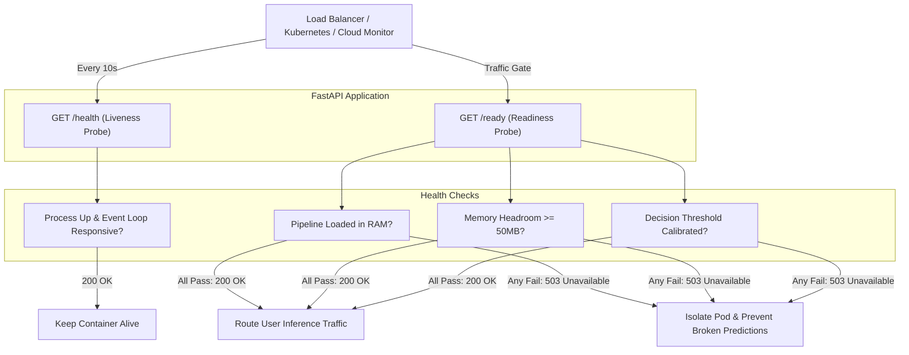

# System Reliability, Resilience & Health Monitoring Strategy

## 1. Reliability Philosophy

A production machine learning application must handle inevitable system degradations gracefully. Rather than crashing or silently generating garbage predictions, the system enforces:
- Explicit separation between liveness and readiness.
- Fail-safe defaults with graceful fallbacks.
- Automated rollback procedures for flawed model deployments.

---

## 2. Health & Readiness Probe Architecture

### Probe Distinction
1. **Liveness (`/health`):**
   - Returns `HTTP 200` with basic uptime and process availability.
   - Used by container orchestrators to detect process deadlocks or fatal memory crashes.
2. **Readiness (`/ready`):**
   - Evaluates whether the model bundle (`churn_pipeline_bundle.joblib`) is deserialized in RAM, the calibrated threshold ($\tau = 0.30$) is active, and host available memory exceeds $50$ MB.
   - Returns `HTTP 200` when ready to serve traffic.
   - Returns `HTTP 503 Service Unavailable` if unready, preventing requests from hitting an uninitialized pod.

---

## 3. Graceful Client Fallback Engine

In [`frontend/utils/api_client.py`](file:///c:/Users/USER/Desktop/Data%20science%20projects/Customer%20Churn%20prediction/frontend/utils/api_client.py), the Streamlit user interface is built with an **autonomous dual-engine pattern**:
- **Primary Channel:** Sends asynchronous HTTP requests to the FastAPI backend at `http://127.0.0.1:8000`.
- **Secondary Channel (Fallback):** If the network connection drops or the API pod is restarting, the client automatically instantiates a local `ChurnPredictor` instance in memory. Business users continue scoring customer churn without interruption.
